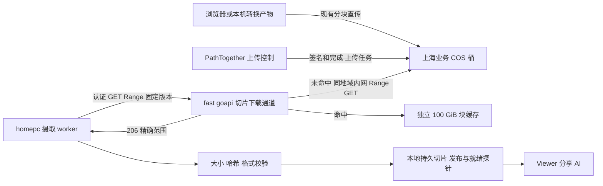

# COS 经 fast 下载与独立切片缓存设计

日期：2026-10-13。状态：Review 与待实现设计。读者：后续实现及部署负责人。

## 结论与范围

目标是让腾讯云 fast 主机通过同地域内网下载 COS，再传给 PathTogether，降低 COS 公网下行费用。建议第一阶段保留浏览器直传 COS、现有上传任务和本地入库流程，仅替换大文件 GET 的传输路径。在现有定制 goapi 服务中增加切片专用下载通道和独立 100 GiB 磁盘缓存，不把切片注册为 Gokapi 临时分享文件。

用户最初提到“上传下载转接”，后续明确主要目的为 fast 下载 COS 节约流量。因此本稿将上传改造列为非必需后续项，不把“所有上传已改走 goapi”作为第一阶段交付承诺。

100G 暂按与 goapi 现有配额一致的二进制口径定义为 **107,374,182,400 字节（100 GiB）**；界面和配置明确单位。该目录放在 fast，存放可重建的下载块；**homepc 的已入库切片是持久资产，不属于这 100 GiB，也不允许按缓存淘汰**。这项缓存定位是依据费用目标作出的设计建议。

本轮没有改运行代码、配置、容量、云盘或服务，没有上传测试对象或执行付费吞吐实验。

## 实际核对结果

| 项目 | 核对结果 |
| --- | --- |
| PathTogether review 基线 | release/viewer-skills-20261011，b723ab31 |
| 当前业务桶 | histopilot-1255456712，ap-shanghai |
| 当前生产 COS 中转池 | 10,000,000,000 字节；产品单次上传上限 9,500,000,000 字节 |
| fast 上 goapi | https://goapi.solarise94.fun；部署目录 /home/ubuntu/gokapi-relay |
| 定制镜像标签 | gokapi-relay:2.2.4-cos7d3 |
| goapi 自有桶 | goapi-1255456712，ap-shanghai，gokapi-relay/ 前缀 |
| goapi 200 GiB 口径 | 本实例元数据中远端文件大小，加 storage 目录本地文件；另保留 512 MiB |
| goapi 本地暂存上限 | 16 GiB；单文件上限 8 GiB |
| goapi 临时文件策略 | 最多保留 7 天，容量不足 FIFO 删除已完成文件 |
| fast 磁盘 | 只有 60 GiB 系统盘；检查时文件系统可用 28,208,406,528 字节，约 26.27 GiB |
| 实际内网解析 | 在 fast 上，两桶的区域域名均解析到 169.254.0.47 |

镜像 ID：`sha256:e6e23ff4098c74cfb8dbd74c4f94c2549654cf83eb6f22b2a686093b33074b34`。
服务附带源码包 SHA256：`e386dd6ee17d586bf30098212296f644b96cd81f7342faa662476dd708bd74d8`。本次审阅的是该部署源码包；未重新构建证明源码与镜像逐字一致。

只读源码副本在 `/mnt/ssd2/tests/goapi-design-20261013/Gokapi-cos`。未读取服务密钥内容。以下 Gokapi 路径以此源码树为根。

## Review 发现

### R1 P1 现有下载接口不满足版本化 Range 合同

PathTogether `cos_client.py:240` 使用 VersionId 和 Range；`cos_ingest_worker.py:530` 严格要求 206、正确的 Content-Range 起止和总长，默认按 8,000,000 字节读取一块。收到 200 会丢弃数据并计入重传预算，不能直接接受。

Gokapi `internal/storage/filesystem/s3filesystem/aws/Aws.go:230` 的 proxyDownload 不接收原始 request，GetObject 只有桶与 key，没有 Range 或 VersionId。它会取整个对象并复制响应体。因此简单把现有 GET URL 换成 UrlHotlink，会导致整文件重复传输、预算耗尽，且失去版本约束。它也只认识自己数据库中的文件，不能自然读取业务桶现有 incoming 对象。

**处置：新增专用通道；不要修改 worker 的校验来适应错误响应，不新增一次“业务桶复制到 goapi 桶”。**

### R2 P1 独立子文件夹不等于独立配额

`internal/storage/RelayQuota.go:90` 递归计数 QUOTA_ROOT，再在第 103 行累加本实例全部远端文件元数据；后续 FIFO 删除也遍历整个文件库。

把新缓存放在 `/app/storage/slides` 会被原 200 GiB 和 16 GiB 本地上限一起计入。只换 COS 前缀、文件名或账户，也不会得到独立预算。

**处置：缓存另挂 `/app/slide-cache`，位于 `/app/storage` 之外；不写 Gokapi files 元数据；使用独立缓存索引、预约和淘汰器。两者都不得清理对方目录。**

### R3 P1 当前磁盘不能实现 100 GiB 本地缓存

fast 整块系统盘只有 60 GiB。把应用上限写成 100 GiB 不能创造容量，也不能防止写满系统盘。

**处置：上线前配置独立数据盘/文件系统，建议至少 120 GiB，缓存应用上限仍为 100 GiB；核实挂载后再启用。目录不在预期挂载点时拒绝启用缓存，不能静默写回系统盘。** 本稿不采购或扩盘。

### R4 P1 临时中转不能承担持久切片的唯一副本

goapi 的 7 天过期和 FIFO 删除会让链接失效；PathTogether 当前则在下载、验证和发布到 `UPLOAD_DIR/objects/<slide_id>` 后清理 COS 源。两边均不能作为“本地切片淘汰后随时回源”的承诺。

**处置：维持当前本地持久资产；只淘汰 fast 的下载缓存。** 原始对象已被清理时，后续缓存 miss 应返回明确的 source_missing，不能伪装成空文件或创建另一个版本。

### R5 P2 迁移整个上传栈并不能直接实现最简设计

现有 goapi 普通 API key 具有账户级操作权限；上传请求专用凭证虽可限制文件数量和大小，但 `chunkreservation/ChunkReservation.go` 的预约存在内存 map 中。重启恢复、幂等完成、覆盖完整性等仍需逐项补齐验证；当前 8 GiB 上限也低于生产允许的 9.5 GB。

此外 `FileUpload.go` 使用进程全局 relayQuotaMutex，上传/完成持锁；不能让新增切片下载也争抢这个锁。

**处置：第一阶段不碰浏览器分块上传，不向浏览器暴露 goapi 服务 API key；专用下载缓存单独锁，不调用上传/分享生命周期。** 若后续确需上传经 fast，另评估进度、续传、取消、幂等完成、任务隔离与上限，不因“有现成 API”跳过这些保障。

## 目标链路



浏览器看图仍由现有本地切片读取和瓦片服务完成；没有把每次拖动、AI 读图都改为远程拉 COS。上传状态文案和 API、ZIP/格式校验、配额结算、slide_id、标注分享权限、失败清理均保留。

fast 通道默认只供 PathTogether worker 调用，不对用户提供永久下载链接，不把原图 URL 暴露给浏览器。现有 Gokapi 200 GiB 分享业务继续运行。

## 最小实施面

1. goapi 定制构建新增独立 `slide relay` 模块：认证、固定 COS 源、版本化 Range 读取、磁盘块缓存、受限指标。复用已有 HTTP 服务与 Go SDK，不复用 files 表和临时分享生命周期。
2. PathTogether 增加一个薄下载适配器，保持 `get_object(key, version_id, range_header, timeout)` 的响应接口。将它用于摄取 worker 的 GET；其余 COS 控制操作继续使用现有 SDK。
3. 新增配置与部署挂载，更新 CSP 无必要：浏览器上传目标没改。不要把服务密钥发到前端。
4. 不改 PathTogether 业务表结构，不新增上传状态机，不导入历史切片，不迁移 COS 对象，不修改 goapi 现有 200 GiB 上限。
5. `COS_DOWNLOAD_TRANSPORT=direct|fast` 为明确运维开关。上线选 fast；fast 故障重试/排队，**不自动回退公网 COS**。人工回退 direct 时接受相应费用并记录。

这仍需少量 Go 代码扩展，不能仅靠配置把现有通用下载接口接上。不要同时引入第二套文件管理平台或把所有 COS 控制职责迁走。

## 专用下载接口合同

以下为**拟新增接口**，不是现有可用 API。

`GET /internal/histopilot/v1/object`

- HTTPS；服务专用 token 从私有文件加载，PathTogether 与 fast 各存一份，不能复用管理员 API key。支持轮换期间两把 key；不记录 token。
- 以受控请求头传入对象 key、非空 VersionId、已确认总大小；`Range: bytes=start-end` 为必需。桶、地域、允许前缀由 fast 配置固定，客户端不能传 URL、endpoint、bucket 或任意请求头。
- 限定业务桶 `incoming/` 对象；拒绝越界、无版本、多范围、负数、过大范围。首版限定与现有 worker 一致的 8,000,000 字节对齐块及尾块，最大单次响应 8,000,000 字节。
- fast COS 身份仅允许业务桶指定前缀的读取/读取版本及必要元数据权限，无写入、删除权限；既有 goapi 桶凭证不能假定已拥有这项权限。
- 每次请求先认证，再命中缓存。fast 构造区域 COS 请求，不跟随到任意外部源。SDK 请求固定 VersionId；检查上游 206、范围、对象总长和返回版本，版本错误不得发布缓存。
- 成功严格返回 206、Content-Range、Content-Length、实际版本；禁压缩，禁止 302 跳回 COS，代理层不缓冲完整文件。可用 `X-Slide-Cache: HIT|MISS|BYPASS` 提供受限诊断。
- 缺版本或非法范围：400/416；源不存在：404；凭证错误：401/403；服务并发满：503 与 Retry-After；源错误：502/504。错误响应小而固定，不含签名 URL/密钥。
- PathTogether 将错误映射到现有重试/终态路径；保留 206 与字节核验、最终 SHA256、readiness probe。不得把 `Cache HIT` 当成业务授权或入库成功。
- 连接、读空闲和总时限必须显式配置，request context 取消能终止 COS GET 和缓存写入；实际值用 8 MB 块和 fast 真实出口带宽验收，不以无限超时兜底。

## 独立 100 GiB 缓存

### 目录和预算

建议新数据盘挂载 `/srv/histopilot-slide-cache`，映射到 goapi 容器 `/app/slide-cache`。启动检查真实挂载、可写、目录 ownership，以及与 `/app/storage` 的 realpath 不重合、不互为父子目录；拒绝符号链接绕过隔离。

```text
/app/storage/                  既有 goapi 文件库 200 GiB 不变
/app/slide-cache/              新挂载 唯一缓存根
  blocks/<digest-prefix>/<digest>.bin
  tmp/<random>.part
  index.sqlite
```

拟配置：`SLIDE_RELAY_CACHE_DIR`、`SLIDE_RELAY_CACHE_MAX_BYTES=107374182400`、`SLIDE_RELAY_CACHE_TTL_SECONDS=86400`、`SLIDE_RELAY_MAX_INFLIGHT=4`。TTL 24 小时和并发 4 是初始设计值，不是性能实测结论。保持有界小缓冲，避免 4 个并发各缓冲整张切片。

100 GiB 是整个目录的上限，包含完整块、暂存块、索引和 WAL；索引/元数据预留从这 100 GiB 内扣除，不是额外额度。建议预留 512 MiB，并限制索引/WAL增长，检查点后按需回收。应用额度 + 文件系统余量双重检查；若要求物理严格硬上限，数据盘另配置目录/项目配额兜底，不能仅用周期性 `du` 称为硬限制。

### 块身份与流程

缓存键使用明确序列化的 `(bucket, key, version_id, block_start, block_length)` 哈希，不用原文件名，不只按 key，不按用户文件内容跨身份去重。

1. 命中完整块并通过元数据/长度核验，增加使用计数后服务；写入时保存校验摘要，发现损坏则隔离并重新读取精确版本。
2. miss 在缓存锁内预约块大小及必要元数据开销；计入“已落盘 + 仍需写入的预约”，同一字节不能既算已用又算全部预约。随后释放总锁再读网络。
3. 同一块并发 miss 合并为一次下载；不同块并行。块先写 `.part`，读满且校验通过后原子 rename，再提交索引。临时文件与目标同卷，不复制第二份全文件。
4. 不需要等整张切片缓存完成。首个 8 MB 块完成即可响应，后续沿用 worker 的断点读取。可先完成单块再返回以简化错误处理；不要后台预取剩余整片。
5. 淘汰采用块级 LRU，只选未在写入、未被请求读取的块。取消或超时释放预约、清理该次临时块；在途块到请求结束再回收。读写全过程保持短锁，网络 I/O 不持全局锁。
6. 接近预算时先删未引用旧块；全部不可淘汰时，不超额落盘。可用有界缓冲直接转发同地域 COS 的该块并标记 BYPASS；全局网络并发满则 503。BYPASS 仍经 fast，不是公网直连回退。
7. 重启先核对 blocks/tmp/index；未完成 `.part` 不命中，原子文件已落盘但无索引可删除后回源。单实例持进程锁，避免两个实例共享目录却各自认为有 100 GiB。
8. TTL 删除、容量删除与异常修复只在此根目录内运行；禁止调用 Gokapi DeleteFile/CleanUp，也不能触及 UPLOAD_DIR 或 COS 源。

持久切片入库后，原有 COS 清理仍执行。fast 缓存最多保留到自身 TTL/LRU；它不是备份。服务仅接受仍有业务权限的 worker 请求。若以后增加“删除即清除所有缓存副本”要求，应加按版本的缓存失效通知并做审计，不把它混入 COS 计费清理。

## 费用与容量解释

腾讯云说明：同地域 CVM 访问 COS 产生的内网上下行流量免费；公网下行按相应计费项收费，COS 请求等其他费用仍可能存在。[官方流量说明](https://cloud.tencent.com/document/product/436/53863)、[内网域名说明](https://cloud.tencent.com/document/product/436/56556)。

本次已验证业务桶与 fast 同地域、区域域名内网解析，但没有通过付费下载与账单归因证明具体节省金额。上线应检查容器内实际 DNS/连接路径及相应账单，不能只凭主机 DNS 就宣布所有请求走内网。

预期净节省 = 被替代的 COS 公网下行费用 − fast 新增公网出口费用 − 新云盘费用 − 其他新增请求/运维成本。fast 的套餐、带宽和超额流量价格本轮未核对，不承诺免费，也不给出无依据的百分比。

**缓存命中率低并不否定方案**：现有摄取通常只把每个对象下载一次，主要收益来自换到同地域内网回源。缓存的收益主要是重试、断点和并发复用；不会减少同等成功传输量的 fast→homepc 公网字节。100 GiB 是最高缓存预算，不要求预填满。

现有 COS 中转池只有 10 GB，与新 100 GiB 读缓存不是同一容量。不要顺手扩业务桶准入上限，也不要把 100 GiB 当成可上传单文件大小。

## 实施顺序与验收

1. 固定当前 goapi 源码与镜像基线；明确新增模块的仓库位置。准备专用数据盘、只读 COS 身份和服务认证，不改原 goapi 配额。
2. 实现专用通道和独立缓存，在隔离实例/测试桶验证；所有本机测试产物放 `/mnt/ssd2/tests/<独立运行目录>`。
3. PathTogether GET 适配器接入，保留旧接口合同和现有任务状态。增加 transport 配置，不替换浏览器上传 SDK。
4. 小范围启用 fast，观察 Range、错误、带宽与缓存计数；确认真实入库和读片后逐步放量。
5. 明确回滚到 direct 会重新产生 COS 公网流量；不需要迁移业务数据或清理已经成功入库的文件。回滚 goapi 时只停止新增通道，原分享服务保持可用。

| 验收案例 | 必须结果 |
| --- | --- |
| 业务桶大于 8 GiB 文件 | 专用 GET 可按块完成，不被通用 goapi 上传 8 GiB 限制误拦 |
| Range 中间块、尾块 | 206、长度、范围、总长均正确；不会返回整文件 200 |
| key 相同 VersionId 不同 | 独立缓存，旧版本不会冒充新版本 |
| wrong Range/早 EOF/断连 | 不发布半块；worker 保留正确断点并计入实际已收字节 |
| 两请求同块/不同块 | 同块只回源一次，不同块不被全局上传锁串行化 |
| 断点重试、worker 换代、取消 | 沿用现有 fencing 和清理；无晚到写入或额外发布 |
| 缓存逼近 100 GiB | 含暂存和索引也不超限；活跃块不删；满时 BYPASS/503 有界 |
| goapi 200 GiB 正在 FIFO 清理 | 切片缓存无变化；切片 LRU 不影响 goapi 分享文件 |
| 数据盘未挂载/只读/ENOSPC | 不写系统盘，不崩溃；有明确错误或按配置禁缓存转发 |
| 重启发生于写一半/rename 后 | 不命中半文件；索引可恢复；预约不永久占用 |
| fast 不可用 | 排队重试；抓包确认无自动 COS 公网兜底 |
| token 无效、任意 URL、越界 key | 先拒绝且零 COS 读取，不泄露凭证与对象信息 |
| 摄取完成并清理 COS 源 | 切片列表、info、thumbnail、tile、分享页、AI 读图仍正常 |
| 全部 fast 缓存被清理 | 已入库切片仍可读，不出现“图片不存在” |
| 内网与费用 | 容器内确认内网回源；分别记录 COS origin bytes、fast egress、缓存命中和重试量，核对账单 |

指标只按低基数结果类型聚合：cache_bytes/reserved_bytes、hit/miss/bypass、origin_bytes、egress_bytes、range_errors、inflight、evictions、retries。不要把 key、文件名或用户 ID 作为监控标签。

## 交接约束

- 已确认：fast 上部署的是上述定制 goapi，目标是经 fast 下载 COS 节约费用。
- 设计建议待实现时落实：100G 按 100 GiB、专用缓存盘位置、24 小时 TTL、并发 4、第一阶段保留浏览器 COS 直传。
- 上线前必须解决：fast 新数据盘、容器真实内网连通、业务桶只读授权、专用服务认证、Range/版本合同和独立配额测试。
- 未验证：真实大文件吞吐、现有 fast 套餐计费、缓存命中收益、源码包与当前镜像可复现构建。此文是设计评审，不是实现完成或上线验收报告。
